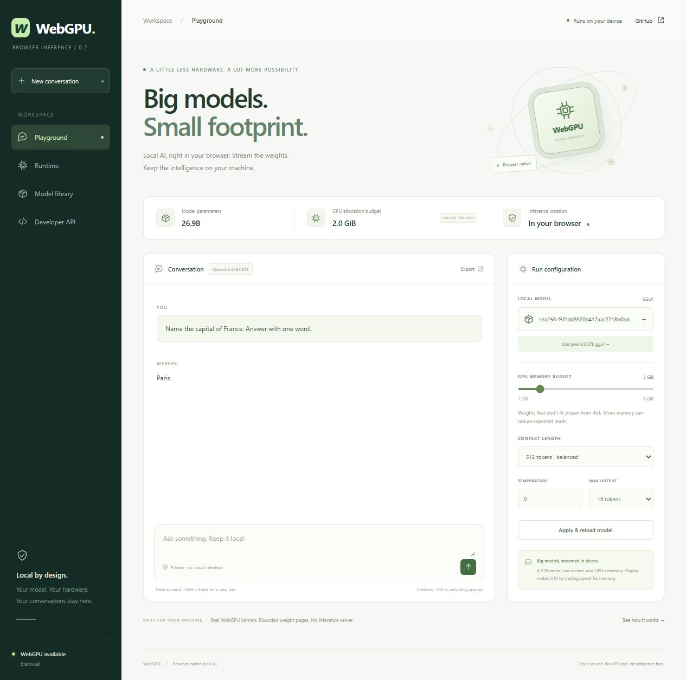
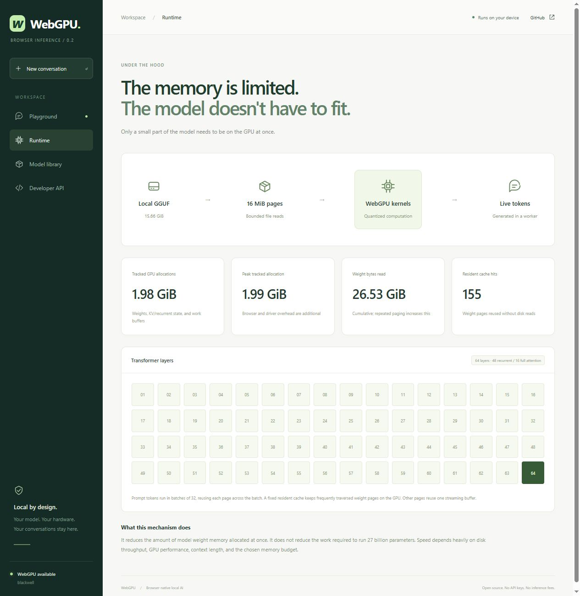
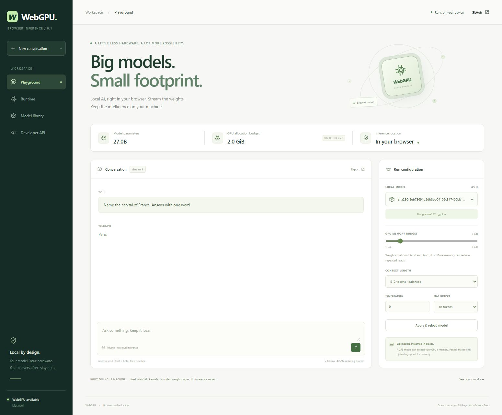
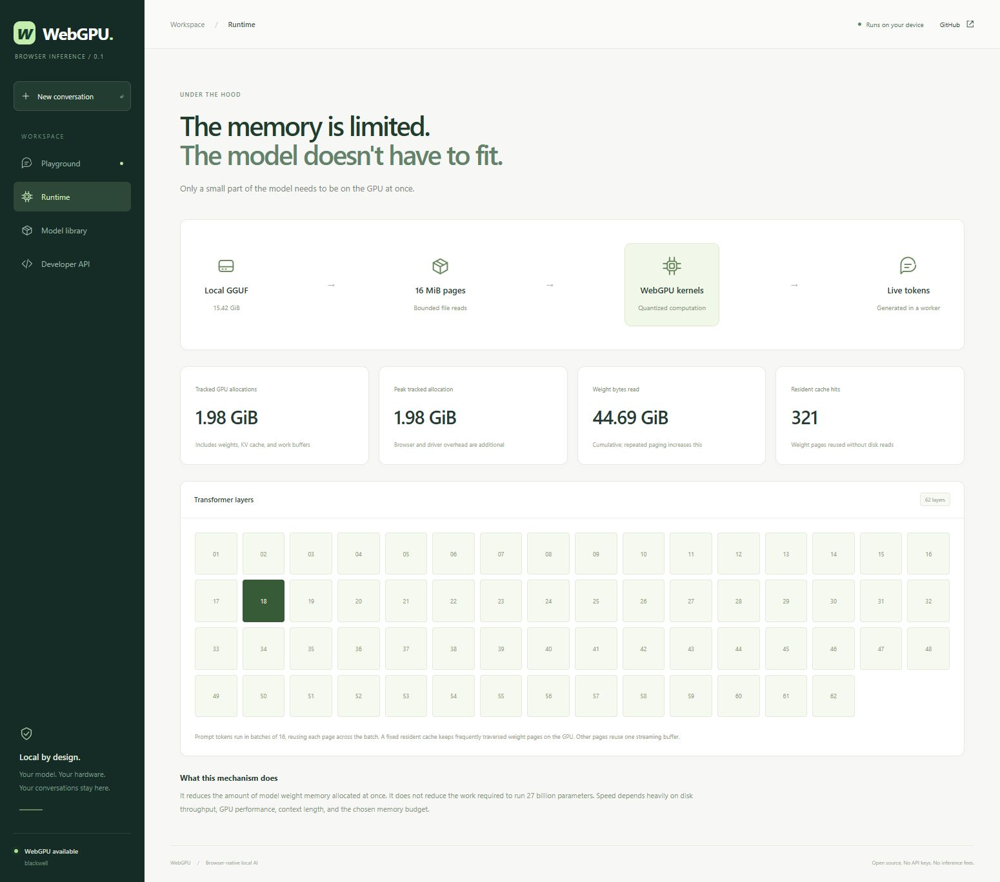
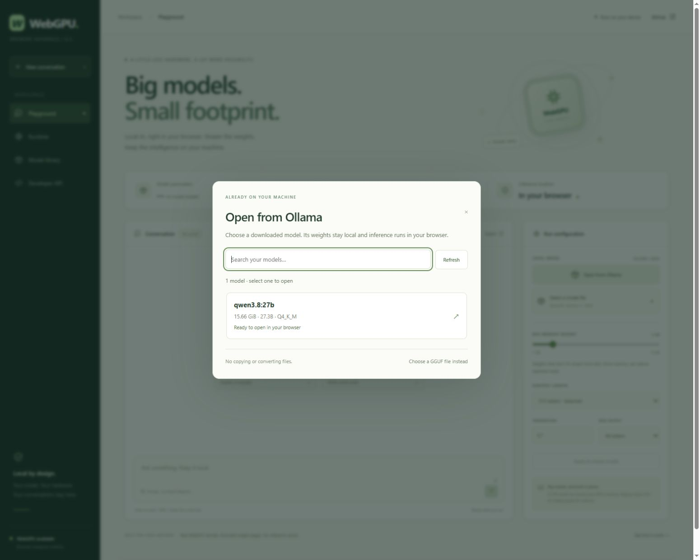
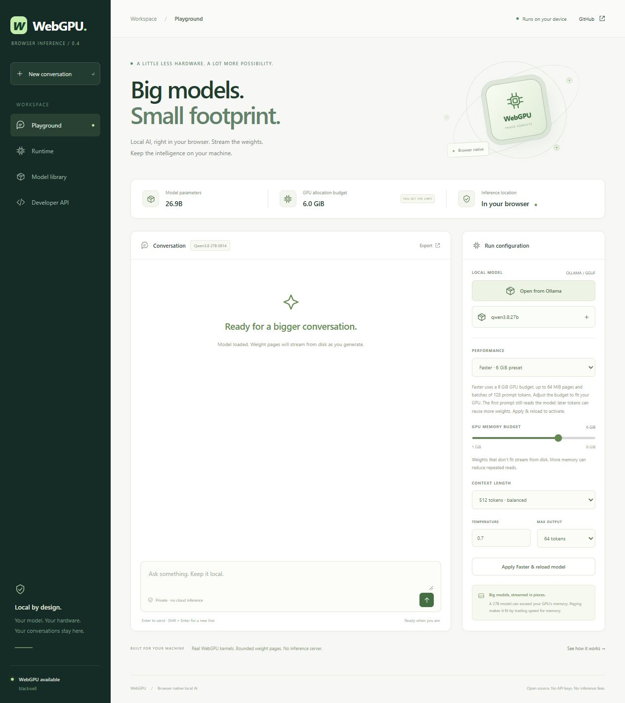

# Validation — 2026-10-19

## Model catalog refresh (0.8.0)

The Model library page no longer leads with Llama 3.2, Qwen2.5, and SmolLM2. It now lists what this engine can run today, newest first:

- **Qwen3.5** (`qwen35`) 0.8B–4B as the recommended tier, with 9B noted as needing the Faster preset and leaving little room for buffers.
- **Qwen3** (`qwen3`) 0.6B–8B as the current dense family.
- **Gemma 3** (`gemma3`) 1B–12B, which is the newest Gemma this runtime executes.
- **Qwen3.8 27B / Gemma 3 27B** as the paged tier, unchanged from 0.7.0.

The page states the ceiling instead of implying it: Gemma 4 and every mixture-of-experts build are rejected at load, because the engine implements dense transformer layers and does not implement the `gemma4` architecture or MoE routing. Older dense families (Llama 3.x, Qwen2.5, SmolLM2, Mistral) still load and are named in the same note.

### Qwen3.5 0.8B with real weights

The dense/hybrid claims were checked against an actual checkpoint, not only synthetic fixtures. `unsloth/Qwen3.5-0.8B-Q4_K_M.gguf` (532,517,120 bytes) was served by `server/serve.mjs --model`, loaded through the built `dist/sdk/sdk.js` in headless Chrome, and generated greedily at a 512-token context on an RTX 5070:

| Item | Observed value |
| --- | --- |
| Architecture | `qwen35`, 24 text layers, 18 recurrent |
| Budget | 2048 MiB (Memory saver), prompt batch 16 |
| Prompt | 23 tokens: "Name the capital of France. Answer with one word." |
| Output | `Paris` (1 token) |
| File reads | 0.48 GiB |
| Peak tracked GPU buffers | 0.54 GiB |
| Load / first token | 9.0 s / 7.4 s |

The file's GGUF metadata carries the hybrid SSM keys (`ssm.conv_kernel`, `ssm.state_size`, `ssm.group_count`, `ssm.time_step_rank`, `ssm.inner_size`) and `full_attention_interval`, so it takes the same Gated-DeltaNet path as Qwen3.8 27B. Its recurrent layer map is absent from the file, so the runtime's every-fourth-layer full-attention fallback applies; the correct answer confirms that pattern for this checkpoint.

`unsloth/Qwen3.5-9B-GGUF` was also inspected: it reports `qwen35` and a 5.29 GiB Q4_K_M file, which fits the Faster preset's weight budget but was not run end to end. Qwen3.5 35B-A3B and 122B-A10B are mixture-of-experts and are rejected.

Gemma 4 was inspected and left out. `unsloth/gemma-4-12b-it-GGUF` reports `gemma4` with new metadata (`rope.freq_base_swa`, `attention.key_length_swa`, `attention.shared_kv_layers`, `embedding_length_per_layer_input`, `attention.sliding_window_pattern`) that this engine does not implement, so no Gemma 4 card is shown.

The UI change was verified in headless Chrome at 1440×1780 and 390×2600 with no console errors; [the model library screenshot](models.png) is regenerated. 67 Node tests, `tsc --noEmit`, and the production build pass.

## Interface rework (0.7.0)

The green interface was replaced with a monochrome, OpenAI-style system: near-black ink on white surfaces, hairline borders, 6–10px radii, black primary actions, monospace labels and values, and a faint 32px drafting grid. Pixel detail is deliberate and restrained — a pixel chip illustration in the hero, a pixel mark shared with the favicon, square status dots, stepped nav markers, and a pixel-grid placeholder for empty layer maps. Colour is now semantic only: red for errors and destructive hover states.

Verified in headless Chrome at 1440×980 and 390×844:
- All four pages render with no console errors or exceptions; the previous wrapping bug in the phone header (badge text colliding with the API chip) is fixed, and the model library dialog matches the new tokens.
- Chat styling separates a right-aligned user bubble from full-width assistant text, checked with a two-message fixture.
- Contrast and hierarchy hold at both widths; screenshots are regenerated from this build: [playground](playground.png), [chat](chat.png), [model library](models.png), [library dialog](library.png), [developer API](api.png), [phone](phone.png).
- 67 Node tests and the production build still pass; no engine, tokenizer, or bridge behaviour changed.

## Small dense models in the browser

The dense decoder (`llama`, `qwen2`, `qwen3`) was checked against an independent CPU reference on real WebGPU hardware, not by reading the source.

- `npm run check:dense` writes three synthetic float32 GGUFs (two layers, 64 hidden, 4 query heads / 2 KV heads, head size 16, 259-token byte-level vocabulary) and runs each through the built browser SDK in headless Chrome with a **512 MiB budget** and 8-token prompt batches. Model bytes were supplied by the loopback byte server through bounded HTTP ranges; a `File` object exercises the same pager.
- The CPU reference is a separate float64 implementation of embedding lookup, RMS norm, GQA attention with a causal loop, both RoPE layouts, SwiGLU, and the output projection. It computes four greedy tokens per model.
- Result: **12/12 tokens matched** for `llama` (adjacent-pair RoPE), `qwen2` (Q/K/V bias), and `qwen3` (per-head Q/K norm with half-split RoPE). Reference prompt was 24 ChatML tokens; the browser processed it in three prompt batches and then decoded three times. Adapter: `blackwell`. Smallest reference top-2 logit margin: **0.19**.
- The fixtures share no weights with real checkpoints and do not measure speed. Real-model coverage for these architectures still depends on the user supplying a GGUF.

Node tests grew to **67 passing** cases. New coverage: GGUF header peeking and truncation, GPT-2/llama-3 pre-tokenization and byte fallback, chat-template detection and rejection, Qwen2 bias and Qwen3 Q/K-norm config detection, mixture-of-experts rejection, budget suggestion per preset, bridge authentication and method validation, and folder-library manifest/blob discovery including traversal rejection.

The UI was driven in headless Chrome: the key chip, masked/revealed key, copy-to-clipboard notice, key rotation with immediate invalidation, origin and client counters, and all three copyable snippets render without console errors. Over `BroadcastChannel`, a wrong key returns `The API key is invalid`, the current key authenticates and returns `No model is loaded yet` when idle, and an unknown method is rejected. Screenshots: [playground](playground.png), [model library](models.png), [developer API](api.png).

## Extended context and output (0.5.0)

- All 32 Node tests pass, including generation of 3,096 deterministic tokens through the real generation loop with a synthetic forward pass. This crosses the old 2,048-token cap and ends at the exact shared-context boundary. No claim of a full 32K model reply is made from that test.
- The actual Qwen3.8 27B Q4_K_M model loaded a 32,768-token context and accepted a 32,768-token output request. It generated `Paris` from a 20-token prompt in 170.7 seconds before manual cancellation. Peak tracked GPU buffers were 5.99 GiB under a 6 GiB budget. This used the browser File API, with no model byte server. [Raw UI result](context-smoke.json). The first HTTP run was interrupted after its source was removed from Ollama storage; it was not an inference failure.
- Real WebGPU tiled attention matches an independent CPU two-pass softmax reference at positions 2,047–2,049 and 32,765–32,767, with head dimensions 128, 256, and 512. Maximum absolute error is below `5e-7`. Sliding-cache wrap is checked for a batch of eight queries at positions 32,760–32,767.
- Existing quantized matmul, Qwen recurrent, normalization, RoPE, and queue-ordering GPU checks still pass. Raw output: [context-gpu-checks.txt](context-gpu-checks.txt).
- Both tokenizers handle 200,000-character messages without overflowing JavaScript's argument stack. Heap BPE is checked against the former scan algorithm with 200 varied inputs, including ties and invalidated neighboring pairs. Existing Qwen reference token IDs remain unchanged.
- UI context options reach 32,768, output options reach 32,768, defaults are 4,096 / 2,048, and individual messages can contain 1,048,576 JavaScript characters. The actual reply is limited to context minus prompt/history/framing, or EOS.
- Browser model tests use local model bytes only; no native or cloud inference is involved. Full 32K prompts and 32K replies have not been benchmarked end to end. Long-context quality is not measured by these kernel checks.

## Qwen3.8 27B generation

The real `qwen3.8:27b` Q4_K_M GGUF generated `Paris` using the standalone browser SDK. The full text model ran in WGSL/JavaScript inside the browser; the loopback server supplied file ranges only. [Raw benchmark record](qwen38-benchmark.json).

| Item | Observed value |
| --- | --- |
| Model | Qwen3.8 27B 0814, mixed Q4_K / Q6_K / F32 GGUF |
| Architecture | `qwen35`: 48 recurrent + 16 full-attention layers |
| Text parameters evaluated | 26,895,998,464; optional MTP layer excluded |
| GGUF file | 16,810,714,464 bytes |
| SHA-256 | `f5f1dd8920d417aac2718b0bda3403da274301efdd6760b4f0f4b864ff2ad57d` |
| Host | Windows, RTX 5070, 12 GB VRAM, 16 GB RAM |
| GPU buffer budget / context | 2,048 MiB / 512 tokens |
| Prompt batch | 32 maximum; 23 prompt tokens, non-thinking ChatML |
| Prompt | `Name the capital of France. Answer with one word.` |
| Sampling | Greedy; one-token SDK smoke test |
| Output | `Paris` (token 57590) |
| Time to first token | 181.9001 seconds, including prompt |
| Time awaiting weight reads | 164.7527 seconds |
| Weight bytes read | 15,810,662,400 |
| Page uploads | 1,223 |
| Resident weight cache | 1,859,842,176 bytes |
| Peak tracked GPU buffers | 2,131,695,744 bytes (1.985 GiB) |

The file contains an optional prediction layer, and input embedding rows are read individually; these are not traversed as full matrices. Consequently the bytes read are smaller than the complete GGUF. This is a smoke test, not a broad quality, long-context, or throughput benchmark. The test used a 12 GB GPU with a 2 GiB engine budget, not an actual 2 GB GPU. Browser/driver overhead and upload staging are additional.

A separate UI run selected the actual weight file through the browser File API, without HTTP requests for model weights. With the same 2 GiB budget, 512-token context, and greedy prompt, it generated `Paris` after **160.2 seconds**, then evaluated the next token and ended its turn normally. This exercises both batched prefill and a subsequent decoding step carrying recurrent/convolution state. The UI displayed **1.99 GiB** peak tracked allocations. These two input paths were tested in different runs; their timings are not a controlled performance comparison.

## Gemma 3 27B generation

The model was evaluated inside the browser using this repository's TypeScript/WGSL runtime. No requests were sent to an Ollama inference endpoint. Ollama was used to download the weights only.

| Item | Observed value |
| --- | --- |
| Model | Gemma 3 27B, mixed Q4_K / Q6_K / F32 GGUF |
| Parameters | 27,009,007,616 |
| Weight file | 16,555,661,472 bytes (15.42 GiB) |
| GGUF SHA-256 | `3eb75691d2db8bb04109c517466bb10bc0e4f035227d1a46cbba2f1d8e6afa45` |
| Host | Windows, RTX 5070 with 12 GB VRAM, 16 GB system RAM |
| Browser adapter | `blackwell`, Chromium-based browser |
| Configured GPU buffer budget | 2,048 MiB |
| Context | 512 tokens |
| SDK prompt batch | 32 tokens maximum; 21 prompt tokens in this run |
| Temperature | 0 (greedy) |
| Prompt | `Name the capital of France. Answer with one word.` |
| Generated token | `Paris` (token 50429) |
| Time to first token, including prompt | 120.2693 seconds |
| Cumulative time awaiting weight reads | 107.8082 seconds |
| Weight bytes read | 16,534,430,010 |
| Page uploads | 1,121 |
| Resident weight cache | 1,572,541,992 bytes |
| Peak engine-tracked GPU buffers | 2,129,510,960 bytes (1.983 GiB) |

The SDK smoke test intentionally stops after one generated token. This validates the full 62-layer forward pass and output projection, but is not a long-conversation, quality, or throughput benchmark. The file bytes in this SDK run came from a loopback **static range server**, which does no inference. The worker performed tokenization, every transformer layer, sampling, and decoding in the browser.

An earlier UI test selected the same local file directly through the browser File API, with **no model-file HTTP requests**. It generated `Paris.` (two tokens) with peak tracked allocations displayed as **1.98 GiB**. Before the scheduling/batching change, that test took 269.0 seconds to the first token and 405.9 seconds to the second; it was then cancelled. These are different runs and input paths, not a controlled speed comparison.

The budget counts engine-created GPU buffers, not total process VRAM. Browser/driver allocations, upload staging, and the OS file cache are additional. The test shows a 27B model running within a small **engine allocation budget on a 12 GB GPU**; it does not establish that an actual 2 GB card will run it, or that all weak GPUs will perform similarly.

## Automated checks

- **24 Node tests passed:** independently packed quantization fixtures; half floats; invalid logits; Unicode fallback and SentencePiece merging; control token isolation; File API bounds; HTTP 206 enforcement; truncated ranges; invalid GGUF files; real Qwen3.8 tensor shapes and MTP exclusion; 17 independent Hugging Face tokenizer examples including NFC, multilingual text, combining marks, emoji, and whitespace; Ollama catalog and selected-model byte-serving integration tests; larger-page caching, adapter/dispatch limits, allocation bounds, and performance-option validation.
- **12 real WebGPU checks passed:** all seven supported matrix tensor formats; batched matrix input/output offsets; causal grouped-query attention; sliding windows; RMS normalization; QK normalization and scaled RoPE; ordered reuse of a weight buffer between dispatches.
- **Qwen GPU checks passed:** interleaved query/gate split, sigmoid output gating, causal depthwise convolution with carried history, L2 Q/K normalization, stable decay and beta, tiled value heads, batched versus sequential Gated DeltaNet with nonzero initial state, state clearing, gated RMS norm, SwiGLU, and partial RoPE (64 of 256 dimensions) at nonzero positions.
- Matrix and recurrent fixtures were also verified with **128-token batches** for Faster mode. The recurrent test compares batched output and final state with token-at-a-time evaluation and an independent CPU equation.
- **Type check, production bundle, standalone SDK emission passed.**
- **Byte-server checks passed:** valid 206 range; rejection of a whole-model GET; invalid-range 416; cross-origin 403.
- The standalone SDK was loaded as native browser ES modules and generated the result above.

## Opening installed Ollama models

The local app discovered the installed `qwen3.8:27b` from its Ollama manifest and opened its existing 16,810,714,464-byte GGUF by name. Browser checks covered opening the picker, search, no results, Refresh, and loading the selected model until the runtime reported ready. No file dialog, copy, conversion, or per-model server argument was used. Model reads use the catalog's bounded range route; inference remains in the browser.

Automated integration checks use isolated model-store fixtures for multiple models and namespaces, unsupported architectures, missing weights, malformed manifests, changed tag identities, correct 206 byte ranges, invalid ranges, unknown model IDs, and cross-origin rejection.

## Faster preset comparison

The browser SDK ran `Write exactly these two words: Paris France` greedily for two output tokens, first with Memory saver and then with Faster, using the same Qwen3.8-27B Q4_K_M file. Both modes used a 512-token context and the same 20-token prompt. Both generated the exact token IDs **57590, 9338**, decoding to `Paris France`.

| Measurement | Memory saver | Faster |
| --- | ---: | ---: |
| Engine GPU budget | 2 GiB | 6 GiB |
| Maximum weight page | 16 MiB | 64 MiB |
| Configured prompt batch | 32 | 128 |
| Time to first token, including prompt | 220.5594s | 136.7362s |
| Additional time for second token | 149.6079s | 84.5120s |
| Total generation time | 370.1744s | 221.2540s |
| First-pass weight reads | 15,810,662,400 bytes | 15,810,662,400 bytes |
| Second-pass weight reads | 13,950,820,224 bytes | 9,761,786,880 bytes |
| First-pass page uploads | 1,223 | 544 |
| Resident weight cache | 1,859,842,176 bytes | 6,048,875,520 bytes |
| Peak tracked GPU buffers | 2,131,695,744 bytes | 6,426,577,920 bytes |

Observed first-token speedup was **1.61×**, and second-token speedup **1.77×**. The larger resident cache reduced second-pass file reads by **30.03%**. Larger pages reduced first-pass uploads even though the same number of bytes was read. The prompt fit in one batch in both modes, so this run does not measure the extra benefit of 128-token batching for longer prompts; that batch size was checked separately against GPU/CPU reference fixtures.

This is a short sequential comparison on Windows with an RTX 5070 (12 GB VRAM) and 16 GB RAM. OS file cache state and concurrent system/GPU activity were not controlled. Timing differences are observations, not a guaranteed speedup on other workloads or hardware. The allocation counter excludes browser/driver resources and upload staging. All model computation stayed in the browser; a local server supplied file bytes only. [Raw events and summaries](speed-benchmark.json).

The UI was also checked by loading a model in Memory saver, selecting Faster, applying the reload, and confirming the runtime displayed **64 MiB pages**, **128-token batches**, and the **6 GiB budget**. Returning to Memory saver restored the 2 GiB preset.

## Remaining limits

No broad model-quality evaluation, long-context stress test, actual 2 GB GPU test, or cross-browser/hardware matrix was performed. Arbitrary architectures, image/audio encoders, split GGUF files, and unimplemented quantization formats are not supported. The first run is slow; the measured workload spent most of its time reading model weights.
